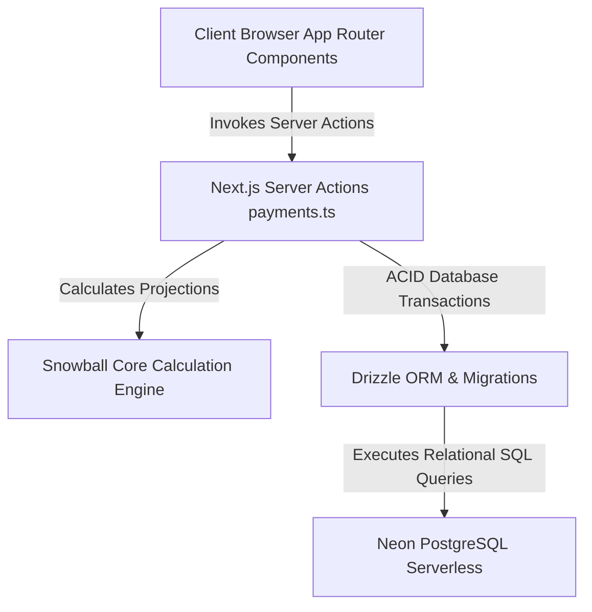
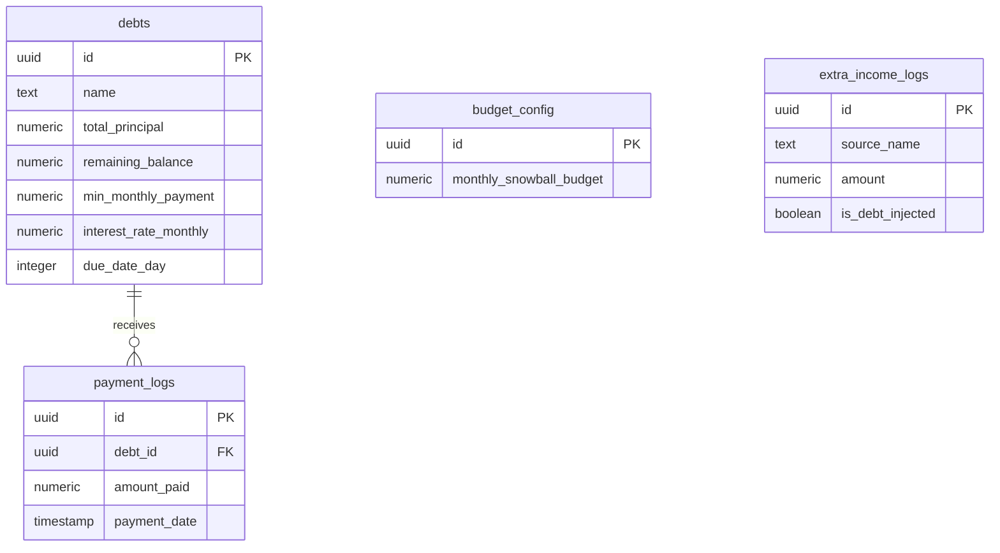

# Midnight Debt Payoff & Income Injection Tracker

## Overview
The Midnight Debt Payoff & Income Injection Tracker is an ultra-performant, responsive dashboard optimized for debt recovery pipelines using the Snowball methodology. It integrates side-hustle/freelance income injections directly into active debt payoff schedules, running on a Next.js 16 App Router, Bun runtime, Drizzle ORM, and Neon PostgreSQL database stack.

The system's design style is a premium dark theme utilizing deep slate and zinc backdrops, high-contrast typography, emerald green highlight metrics, and soft amber deadline warning accents.

---

## Design System Tokens

### Colors
* **Background** (`#09090b`): Deep base zinc-950 color for primary page canvas.
* **Surface** (`#18181b`): Card surfaces, panel containers, and dialog bodies (zinc-900).
* **Surface Hover** (`#27272a`): Interactive list items and card hover states (zinc-800).
* **Border** (`#2e2e33`): Muted dividers, input outlines, and component boundaries.
* **Primary (Emerald)** (`#10b981`): Progression indicators, positive extra payment badges, payoff metrics.
* **Primary Hover** (`#059669`): Filled CTA interactive hover states.
* **Secondary (Amber)** (`#f59e0b`): Imminent due dates, warnings, and deadline countdown indicators.
* **Text Primary** (`#fafafa`): Headings, body text, primary labels (zinc-50).
* **Text Secondary** (`#a1a1aa`): Muted descriptions, metadata, inactive labels (zinc-400).
* **Danger** (`#ef4444`): Delete actions, overdraft states, negative indicators.

### Typography
* **Display Font**: Inter / System Sans (sans-serif)
* **Body Font**: Inter / System Sans
* **Code Font**: JetBrains Mono / System Monospace

### Elevation & Shadows
* **Flat**: Standard dashboard widgets and forms sit flat with a `1px` border (`border-[#2e2e33]`).
* **Active Elev**: Cards gain a subtle glow/shadow on hover (`shadow-[0_8px_30px_rgb(0,0,0,0.3)]`).

### Spacing & Grid
* Mobile: Single column, `16px` padding, `16px` gap.
* Desktop: Grid layouts with `24px` padding, `24px` gap, max-width `1440px`.

---

## System Architecture

---

## Database Relational Model

---

## Components Outline

1. **Dashboard Overview Metrics Grid**:
   - Total Debt: Cumulative `remaining_balance` across all accounts.
   - Monthly Base Snowball: Defined extra payment amount from `budget_config`.
   - Projected Payoff Date: Exact month/year calculated by the snowball engine.
   - Active Pipelines: Count of active debts (remaining balance > 0).

2. **Active Payoff Chart (Recharts Area/Line)**:
   - Visual timeline demonstrating the decay curve of total remaining debt month by month.
   - Contrasts the baseline minimum payment path vs. the accelerated Snowball path.

3. **Active Pipelines List**:
   - Individual debt cards with progressive tracking bars.
   - Includes indicators for interest rates and upcoming due dates (warns in Amber if due within 3 days).

4. **Income Injection & Payment Ledger Forms**:
   - Floating Modals or sidebar panels to log freelance payments.
   - Dynamic toggle: "Directly Inject to Smallest Debt".

5. **Audited Transaction Ledger**:
   - Double-entry list containing payments and freelancing income side-by-side.

---

## Do's and Don'ts
* **DO** use decimal-precise rounding (`number` or `string` equivalents of postgres numeric) to avoid floating-point math issues.
* **DO** roll over excess budget from a paid-off debt to the next smallest debt instantly in the engine.
* **DON'T** use harsh neobrutalist styling; maintain clean, rounded borders (`rounded-xl` / `rounded-2xl`), subtle borders, and smooth transitions.
* **DON'T** leave database connections unpooled or unclosed during Server Action executions.
